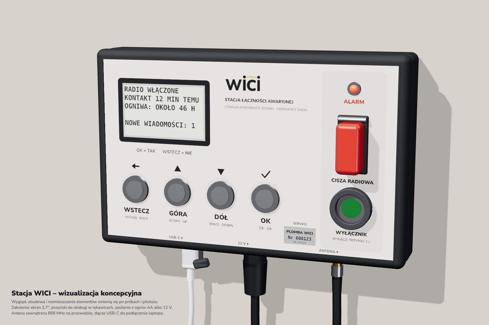

<p align="center"><picture><source media="(prefers-color-scheme: dark)" srcset="media/logo/WICI-na-ciemnym.svg"></picture></p>

<h1 align="center">Łączność awaryjna, gdy milkną telefony</h1>

Gdy nie ma prądu, zasięgu komórkowego ani internetu, jak przekazać służbom, że w schronieniu brakuje wody, ktoś potrzebuje lekarza albo transportu? **WICI to otwarty projekt stacji radiowej do krótkich zgłoszeń i odpowiedzi.** Sieć ma łączyć miejsca, w których gromadzą się ludzie, ze stanowiskiem odbiorczym wyznaczonym przez gminę.

Gospodarz schronienia wybiera na ekranie kategorię potrzeby i liczbę osób, a stacja wysyła zgłoszenie radiem. Ekran ma rozróżniać trwały zapis u odbiorcy, odczyt przez dyżurnego i decyzję o pomocy. Każda włączona stacja ma też przekazywać wiadomości sąsiadów, wydłużając drogę do odbiorcy.

<p align="center"></p>
<p align="center"><sub>Wizualizacja koncepcyjna stacji według dzisiejszych założeń; <a href="hardware/obudowa/README.md">obudowa i render</a>, <a href="hardware/obudowa/render/stacja-materialy.png">pełna rozdzielczość</a>.</sub></p>

**Wypróbuj stację w przeglądarce:** [symulator](https://wici.net.pl/symulator/) uruchamia ten sam program co prawdziwa stacja, z ćwiczeniami gospodarza i stanowiskiem odbiorczym. Uwagi zgłosisz przyciskiem „Zgłoś uwagę” albo [formularzem](https://github.com/tmierzwa/WICI/issues/new?template=uwaga-symulator.yml).

**To projekt prototypu 0.5. Stacji jeszcze nie zbudowano ani nie sprawdzono w terenie.** Dokumentacja, obliczenia i kod są otwarte; poniżej opisujemy plan prac i możliwości współpracy.

Podstawowy zestaw to stacja z ekranem, przyciskami, anteną i ogniwami AA. Cel: co najmniej 48 godzin pracy na ogniwach i dłuższa praca ze źródła 12 V. Pilotaż planujemy na gotowej płytce ESP32-S3 z radiem LoRa SX1262. Zasięg i czas pracy muszą zostać potwierdzone pomiarami.

W schronieniu stacja ma działać samodzielnie. Laptop może później dodać wygodniejszy panel, a router Wi-Fi umożliwi korzystanie z lokalnej strony do zgłoszeń z telefonów, bez instalowania aplikacji. Na stanowisku odbiorczym komputer jest obowiązkowy: dyżurny przyjmuje na nim zgłoszenia i przekazuje je służbom.

Sieć trzeba przygotować razem z gminą i służbami przed kryzysem: zamontować anteny, sprawdzić trasy radiowe i uzgodnić dyżury. WICI ma uzupełniać lokalny system ochrony ludności. Nie zastępuje numeru 112 ani organizacji pomocy.

## Gdzie jesteśmy

Stan przygotowania testów na 21 października 2026 r.:

- **R0:** dwa zestawy Seeed 102010611; próba przy stole zaliczona (100/100 w obie strony). Pierwsze próby zasięgu w budynku przy mocy 0 dBm: trasa około 20 m przez 2 ściany zaliczona 100/100, dwie trudniejsze trasy leżą na granicy zasięgu tego profilu ([wyniki](hardware/radio-pair/evidence/range-r0-2026-10-10.txt)). Następny krok: próby w terenie.
- **L0:** płytki N1 z JLCPCB, części, panele i moduły na dwa prototypy kupiłem sam ([zamówienie](hardware/dev-bench/przed-produkcja.md#zamówienie-2026-10-10-l0)); dotarły i czekają na montaż. Montaż i uruchomienie wykonuje zewnętrzny wykonawca według [zlecenia](hardware/l0-diagnostic/ZLECENIE.md) i [instrukcji z diagnozą usterek](hardware/l0-diagnostic/MONTAZ-I-TESTY.md). Najpierw jeden L0 z programem diagnostycznym `l0-0.5`, drugi po udanym uruchomieniu pierwszego.
- **Oprogramowanie stacji dla L0:** obraz `l0-0.2` ma własny sterownik SX1262 w profilu LoRa pilotażu, polecenia pomiarowe i tryb pracy do badań EMC ([opis](firmware/README.md#stacja-l0-l0), [etap 1](https://github.com/tmierzwa/WICI/issues/21)). Jest skompilowany i sprawdzony testami na komputerze z modelem układu, ale nie uruchomiono go jeszcze na płytce. Interfejs LoRa w stosie Reticulum ([etap 2](https://github.com/tmierzwa/WICI/issues/22)) i funkcje przed pierwszymi stacjami w terenie ([etap 3](https://github.com/tmierzwa/WICI/issues/23)) są do zrobienia.
- **Płytka stacji pilotażowej:** [porównanie czterech kandydatów](docs/spec/elektronika.md#porównanie-kandydatów) wskazuje RAK3312 na płytce bazowej RAK19007 jako głównego kandydata; wyprowadzenia do stacji wymagają ekspandera. Żaden kandydat nie ma dotąd podpisanej deklaracji zgodności UE producenta ([dokumenty](docs/spec/elektronika.md#dokumenty-zgodności-kandydatów)). 21 października wysłano zapytanie do RAK o deklarację dla RAK3312 i RAK19007, raporty radiowe i stanowisko wobec EN 18031. Wybór płytki zapadnie po próbach na dwóch L0.

Zakres prototypu L0 (przygotowany do wyceny, teraz podstawa zlecenia montażu) i zasady wyboru dokumentów są w [dokumentach przygotowania testów](output/README.md). Instrukcje bieżących prób opisuje [hardware](hardware/README.md).

W repozytorium są:

- [koncepcja](https://wici.net.pl/);
- specyfikacja stacji;
- model obliczeniowy z testami;
- projekt płytki nośnej stanowiska deweloperskiego (N1) i rozpoczęty projekt płytki stacji R02 (wstrzymany);
- oprogramowanie stacji skompilowane dla stanowisk deweloperskich A i B oraz dla L0, ze stosem Reticulum (bez LXMF); nie uruchomiono go jeszcze na sprzęcie;
- aplikacja laptopa uruchamiana z pamięci USB: przygotowanie stacji (etap 1) i zaszyfrowana baza (etap 2, warstwa bazy).

Do wykonania pozostają montaż i próby L0, interfejs LoRa w stosie, integracja LXMF na stacji, aplikacja stanowiska odbiorczego oraz próby sprzętu i obsługi.

Po przeglądzie z 8 października 2026 r. przyjęliśmy następującą [kolejność prac](docs/concept/08-plan-weryfikacji-i-decyzje.html#kolejnosc-prac):

1. Etap 0: pomiar tłumienia tras gotowymi urządzeniami 868 MHz (w tym LoRa SF7 i SF8) oraz ćwiczenie przy stole z gminą i odbiorcą, bez własnego sprzętu.
2. Stacja na gotowej płytce ESP32-S3 z układem LoRa SX1262: interfejs radiowy, Reticulum i LXMF, trwała kolejka w pamięci FRAM, ekran i przyciski.
3. Aplikacja stanowiska z Reticulum i LXMF w Pythonie.
4. Pilotaż: 6–8 stacji pilotażowych, 3 miejsca, co najmniej 3 miesiące z zimą.
5. Po pilotażu: decyzje o własnej płytce R02, drugim wykonaniu, ocenie zgodności, poziomach 2–3 (laptop, router) i szyfrowaniu FRAM.

Wybrany profil pilotażu to LoRa SF7 na kanale 869,525 MHz. Zakres deklaracji zgodności UE kupionych płytek i warunki prób terenowych trzeba ustalić przed pilotażem. Własny profil P1 (CC1120, S2-LP) zostaje wariantem zapasowym. Projekt płytki R02 jest wstrzymany do decyzji po pilotażu.

## Jak możesz pomóc

Najbliższy cel to pierwsza wymiana zgłoszeń między stacjami i stanowiskiem odbiorczym, a następnie próby w rzeczywistych miejscach. Przydadzą się doświadczenie w radiu i antenach, oprogramowaniu ESP32-S3 i SX1262 oraz organizacji pomocy w gminie.

Można też pomóc bez sprzętu: sprawdzić obliczenia zasięgu, energii i ruchu radiowego albo uprościć kartę obsługi i poprawić tłumaczenia, zwłaszcza ukraińskie.

Konkretne zadania opisuje [CONTRIBUTING.md](CONTRIBUTING.md#od-czego-zacząć). Jeśli chcesz podjąć jedno z nich lub wskazać błąd, otwórz [Issue](https://github.com/tmierzwa/WICI/issues). Drobne poprawki możesz od razu przesłać jako PR.

## Co jest w repozytorium

| Katalog | Zawartość |
|---|---|
| [docs/concept](docs/concept/index.html) | Koncepcja: potrzeby, scenariusze, dostępne rozwiązania, architektura, wykonalność, zagrożenia, plan prób i otwarte decyzje; [strona online](https://wici.net.pl/) |
| [docs/spec](docs/README.md) | Specyfikacja stacji, warunki odbioru i lista części |
| [firmware](firmware/README.md) | Oprogramowanie stacji dla stanowisk deweloperskich A (nRF52840-DK + CC1120EM, na przewodach i na N1) i B (ESP32-S3-DevKitC-1 + X-NUCLEO-S2868A2 na N1) oraz dla L0 (ESP32-S3-DevKitC-1 + Wio-SX1262 na N1, profil LoRa); skompilowane, jeszcze nie uruchomione na sprzęcie |
| [software/reference](software/reference/README.md) | Model wiadomości i potwierdzeń z testami; obliczenia zasięgu, energii i czasu nadawania |
| [software/laptop](software/laptop/README.md) | Aplikacja laptopa z pamięci USB (Windows, macOS, Linux), etap 1: przygotowanie stacji przez USB; [plan](software/laptop/PLAN.md) kolejnych etapów |
| [software/simulator](software/simulator/README.md) | Symulator stacji w przeglądarce: obraz bench-b oprogramowania stacji (te same źródła i flagi) na wirtualnej płytce ESP32-S3 z emulacją S2-LP, FRAM i Sharp, węzeł i stanowisko odbiorcze, panel R02 i N1 w skali, ćwiczenia gospodarza; [online](https://wici.net.pl/symulator/) |
| [hardware](hardware/README.md) | Testy radiowe R0, diagnostyka prototypu L0, projekt nośnej N1 i dokumentacja przyszłej płytki R02 (wstrzymanej do decyzji po pilotażu) |
| [media/film](media/film/README.md) | Dwa filmy o projekcie: około 4,5 min i 60 s |
| [media/infografika](media/infografika/README.md) | Infografika do mediów społecznościowych: post i Stories (PL, EN) |
| [media/logo](media/logo/README.md) | Znak WICI i ikony |
| [tools](docs/development.md) | Kontrola repozytorium i tworzenie paczki źródłowej |

Sprawdzenie repozytorium wymaga tylko Pythona 3.12 lub nowszego:

```sh
python3 -m unittest discover -s software/reference -v
python3 -m unittest discover -s tests -v
python3 tools/verify_repository.py
```

W zgłoszeniu zmiany (PR) użyj `python3 tools/verify_repository.py --pull-request` ([szczegóły](CONTRIBUTING.md#kontrole-przed-pr)). Środowisko CAD opisuje [docs/development.md](docs/development.md).

## Kto za tym stoi

Na razie projekt prowadzi jedna osoba: [@tmierzwa](https://github.com/tmierzwa). Kontakt dla gmin, służb, krótkofalowców i mediów: [kontakt@wici.net.pl](mailto:kontakt@wici.net.pl); sprawy techniczne najlepiej zgłaszać w Issues. Duża część analiz, obliczeń i dokumentacji powstała z pomocą asystenta AI (Claude); takie commity mają wiersz `Co-Authored-By`.

Autor przegląda każdą zmianę. Obliczenia i założenia prawne czekają na niezależny przegląd; wyniki modelu wymagają potwierdzenia pomiarami.

Projekt jest otwarty; licencje dopuszczają zastosowania komercyjne. Kod jest na licencji MIT, konstrukcja na CERN-OHL-P-2.0, a dokumentacja na CC-BY-4.0. Szczegóły są w [LICENSE.md](LICENSE.md). Podatności zgłaszaj prywatnie według [SECURITY.md](SECURITY.md). Obowiązuje [kodeks postępowania](CODE_OF_CONDUCT.md).

## In English

WICI is an open-source project for an emergency radio station for shelters in Poland. It is designed to send short requests for help when power, mobile networks and the internet are down. A station with a screen, buttons and AA cells would send requests, show acknowledgements and decisions, and relay neighbouring stations’ messages. The receiving post needs a computer and an agreed procedure for passing requests to emergency services.

The project is at the **prototype design stage (0.5)**. No station has been built or field-tested. The planned pilot uses off-the-shelf ESP32-S3 boards with an SX1262 LoRa radio; the custom board and the project's own FSK profile are deferred until after the pilot. Range and battery life remain to be measured.

One person currently maintains the project with AI assistance. Help with radio, firmware, civil protection, field testing and independent review is welcome. Documentation is in Polish; issues and pull requests in English are welcome. See [CONTRIBUTING.md](CONTRIBUTING.md#in-english). Contact: [kontakt@wici.net.pl](mailto:kontakt@wici.net.pl).
