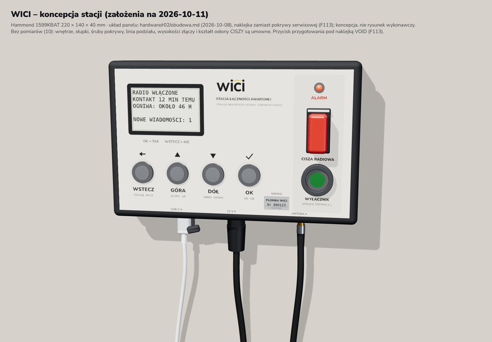
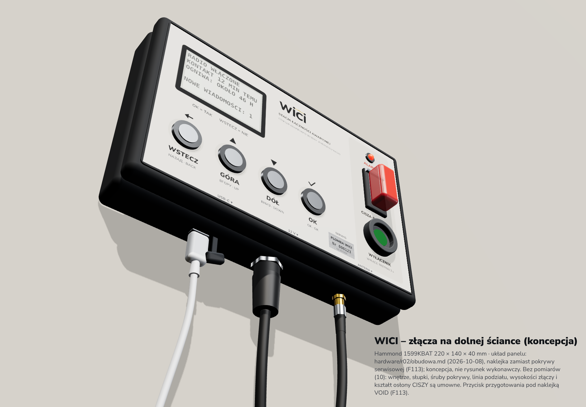

# WICI: obudowa stacji (szkielet)

**Status 2026-10-11: szkielet bez geometrii. Nie drukować, nie zamawiać.** Katalog zbiera założenia obudowy w jednym miejscu i odmawia wygenerowania części, dopóki nie ma pomiarów z przymiarki. Wygląd stacji pokazuje tylko render koncepcyjny.





Do materiałów: [render/stacja-materialy.png](render/stacja-materialy.png), 3600 × 2400 px (na stronę i README: [stacja-materialy-web.jpg](render/stacja-materialy-web.jpg), 1800 × 1200 px, około 125 KB), z krótkim podpisem „wizualizacja koncepcyjna”: stacji jeszcze nie zbudowano, wygląd zmieni się po próbach i pilotażu.

Render pokazuje założenia z [obudowy R02](../r02/obudowa.md) z 2026-10-08: Hammond 1599KBAT (220 × 140 × 40 mm), ekran Sharp LS027B7DH01A w oknie 61,5 × 38 mm, cztery przyciski PV6 w rozstawie 32 mm, kolumna ALARM, CISZA z osłoną i wyłącznik główny, przycisk przygotowania za otworem Ø4 mm pod numerowaną naklejką VOID (zamiast plombowanej pokrywy serwisowej, [F113](../../docs/review.md)) oraz USB-C, 12 V (EN3) i SMA na dolnej ściance. Na ekranie jest ekran główny z [oprogramowania](../../docs/spec/oprogramowanie.md#ekran-i-przyciski-stacji), a na folii panelu nazwy przycisków z [karty](../../docs/spec/karta.md) i jej wersji UK i EN. Umowne są: wnętrze, słupki, śruby pokrywy, linia podziału, wysokość osi złączy, kształt osłony CISZY i kolor wyłącznika.

## Dwa etapy

1. **Obudowa L0:** obudowa drukowana 3D (PETG albo ASA) dla płytki nośnej N1 z DevKitC, Wio i panelem, do prób czytelności i obsługi (T8). Otwory liczy się z plików N1 (`positions.csv`, `plytka-nosna.kicad_pcb`), a nie z ich przepisanej kopii. Ograniczenie: N1 ma przyciski 12 mm w rozstawie 16 mm, więc obsługi w rękawicach na L0 nie da się sprawdzić.
2. **Obudowa pilotażowa:** kupiona skrzynka V-0 (propozycja: Hammond 1599KBAT) z obrobionym frontem, folią panelu i drukowanym wkładem tylko w środku, dla 6–8 stacji ([stacja pilotażowa](../../docs/spec/elektronika.md#stacja-pilotażowa)). Wkład zależy od płytki MCU+SX1262 wybranej do pilotażu.

## Co jest znane, a co trzeba zmierzyć

Znane wartości mają źródło w repozytorium: obrys N1 (170 × 100 mm), 9 otworów montażowych, położenia części, wymiary panelu Sharp i układ panelu R02. Pomiary są w `zalozenia.py` (`MEASUREMENTS`) i mają wartość `None`, dopóki nie zostaną zmierzone:

| Pomiar | Skąd |
|---|---|
| wysokość DevKitC w gniazdach J5/J6 nad N1 | suwmiarka po wpięciu DevKitC |
| wysokość nasadki przycisku nad N1 | zmontowana N1 |
| wysokość szkła panelu nad N1 | po teście ekranu i przyklejeniu |
| długość wolnej taśmy FPC | przymiarka z panelem |
| położenie i wysokość Wio z adapterem, wyjście u.FL | po montażu L0 |
| położenie gniazda USB/OTG DevKitC | po wpięciu DevKitC |
| słupki i śruby pokrywy Hammond 1599KBAT | model STEP albo próbka |
| płytka MCU stacji pilotażowej | decyzja przed pilotażem |
| obrys i wysokość osłony GT-4R | karta i próbka |

Największe ryzyko L0 to różnica wysokości: panel leży około 2,5 mm nad N1, a DevKitC w gniazdach 8,5 mm sięga znacznie wyżej. Pokrywa potrzebuje więc wgłębionego, fazowanego okna albo garbu nad DevKitC. Wybór zapada po pomiarze, nie wcześniej.

## Następne kroki

Stan 2026-10-11: przed testami i pomiarami nic więcej w obudowie się nie projektuje. Każdy krok ma swój wyzwalacz.

| Kiedy | Krok |
|---|---|
| teraz, decyzja opiekuna projektu | jeden komplet próbek do przymiarki (około 100–150 USD): Hammond 1599KBAT, cztery przyciski PV6, osłona GT-4R z przełącznikiem GTS, gniazdo EN3 z wtykiem, koszyk BH4AAW; sprawdza obsługę w rękawicach przy rozstawie 32 mm, wysokość osłony CISZY, słupki i śruby pokrywy oraz miejsce na koszyk; nie zależy od wyboru płytki pilotażowej ([obudowa R02](../r02/obudowa.md) ma status „nie zamawiać”, więc zakup wymaga decyzji) |
| po dostawie L0, przed lutowaniem | przymiarka 1:1 ([przed produkcją](../dev-bench/przed-produkcja.md#zamówienie-2026-10-10-l0)) i wpisanie pomiarów do `MEASUREMENTS` w `zalozenia.py`: wysokości DevKitC, nasadki przycisku i szkła panelu, długość taśmy FPC, położenie Wio z u.FL i gniazda USB/OTG |
| po komplecie pomiarów L0 | generator `build.py` (build123d): drukowana obudowa L0 z PETG albo ASA, szablon wiercenia 1:1, test zgodności otworów z N1; wybór między wgłębionym oknem a garbem nad DevKitC |
| po wyborze płytki pilotażowej (`pilot_board`) | wkład montażowy modułów w kupionej skrzynce, obróbka frontu (szablon albo CNC), folia panelu PL/UK/EN; jedna sztuka, próba montażu i T8, potem 6–8 sztuk |
| po pilotażu | obudowa R02: model STEP Hammonda, obrys płyty bazowej, klasa palności, ESD, próba klimatyczna; ocena pokrywy z plombą wobec naklejki ([F113](../../docs/review.md)) |

## Pliki

| Plik | Rola |
|---|---|
| `zalozenia.py` | jedno źródło założeń: koncepcja panelu, geometria N1 z plików płytki, lista pomiarów; `--json` odświeża `render/uklad.json` |
| `build.py` | punkt wejścia generatora; bez kompletu pomiarów wypisuje braki i kończy się kodem 2 |
| `render/stacja.html`, `render/render.js` | scena three.js i zapis PNG przez Playwright |
| `render/uklad.json` | dane sceny z `zalozenia.py`; test sprawdza, czy są aktualne |
| [tests/test_obudowa.py](../../tests/test_obudowa.py) | zgodność z plikami N1, reguły układu panelu z dokumentu R02, odmowa generowania |

```sh
python3 hardware/obudowa/zalozenia.py --json   # po zmianie założeń
python3 hardware/obudowa/build.py              # dziś: lista brakujących pomiarów, kod 2
cd hardware/obudowa/render && npm install --no-save three@0.160.0 playwright && node render.js
```

`render.js` podaje three.js z lokalnego `node_modules`, a bez niego pobiera bibliotekę z jsDelivr. Generator geometrii (build123d: STEP, STL, szablon wiercenia 1:1) dopisuje się dopiero po przymiarce. Licencje: skrypty MIT, dokumentacja i rendery CC-BY-4.0, przyszłe pliki konstrukcyjne CERN-OHL-P-2.0 ([LICENSE.md](../../LICENSE.md)).
