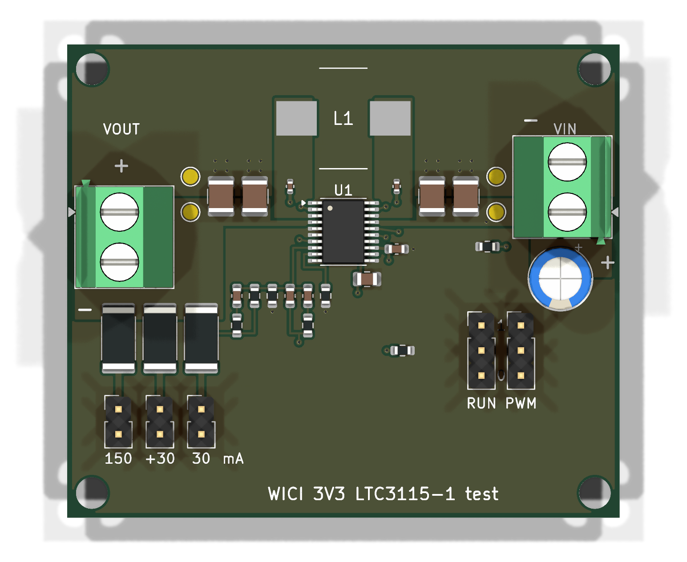

# Płytka testowa przetwornicy 3,3 V (LTC3115-1)

Mała płytka do pomiaru sprawności przetwornicy z [projektu zasilania](../r02/zasilanie.md) przed schematem v2 (Z11). Układ i wartości elementów są te same co w projekcie: 3,3 V, 750 kHz, dławik 15 µH, dzielnik 1 MΩ / 432 kΩ, kompensacja typu III.

Dlaczego pomiar jest potrzebny:

- karta LTC3115-1 (rew. E) ma krzywe sprawności tylko dla 5 V, a płytka ewaluacyjna DC1687B (około 230 USD) też jest ustawiona na 5 V i ma krzywe od 100 mA;
- model LTspice producenta zawyża sprawność o 8–25 punktów względem krzywych z karty, więc się do tego nie nadaje;
- z krzywych dla 5 V wychodzi dla 3,3 V przy 30–60 mA w Burst Mode około 74–83%. Przy dolnej granicy model energii daje około 47 h, czyli mniej niż W23 (48 h).

## Układ

| Element | Wartość | Połączenie |
|---|---|---|
| U1 | LTC3115EFE-1 (TSSOP-20 z padem termicznym) | piny 1, 5, 6, 10, 11, 20 i pad: GND; 12 i 14: VCC; 13 i 17: VIN; 4: VOUT |
| L1 | 15 µH, Bourns SRP1038A-150M | SW2 (pin 3) – SW1 (pin 18) |
| C1, C2 | 10 µF 50 V X7R 1210 | VIN – GND |
| C3, C4 | 22 µF 16 V X5R 1210 | VOUT – GND |
| C5 / C6 | 100 nF 16 V 0402 | BST1 (16) – SW1 / BST2 (15) – SW2 |
| C7 | 100 nF | VIN (13) – GND |
| C8 | 10 µF 25 V 0805 (przy 4,45 V zostaje około 6 µF, karta wymaga ≥4,7 µF) | VCC – GND |
| C12 | 47 µF 25 V elektrolityczny, przewlekany | VIN – GND przy zacisku: pojemność na przewody zasilacza i amperomierz (karta s. 11) |
| R9 / R10 | 10 MΩ / 100 kΩ | RUN – GND / PWM/SYNC – GND: stan niski bez zworki |
| R1 | 47,5 kΩ | RT (9) – GND: 750 kHz |
| R2 / R3 | 1 MΩ / 432 kΩ | VOUT – FB (8) – GND: 3,31 V |
| C9 | 82 pF (C_POLE) | FB – VC (7) |
| C10 + R4 | 3,9 nF + 20 kΩ szeregowo (C_FB, R_FB) | FB – VC |
| C11 + R5 | 82 pF + 20 kΩ szeregowo (C_FF, R_FF) | FB – VOUT |
| R6, R7 | 110 Ω 1 W 2512, zworki JP1, JP2 | VOUT – GND: po 30 mA |
| R8 | 22 Ω 1 W 2512, zworka JP3 | VOUT – GND: 150 mA |
| JP4 | listwa 1×3: VIN / RUN / GND | zworka 1–2 pracuje, 2–3 wyłączenie |
| JP5 | listwa 1×3: VCC / PWM/SYNC / GND | zworka 1–2 PWM, 2–3 Burst Mode; środkowy pin przyjmuje zegar SYNC |
| J1, J2 | zaciski Phoenix 5,08 mm | wejście VIN i wyjście VOUT (obciążenie zewnętrzne) |
| TP1–TP4 | pola pomiarowe | VIN i GND przy C1, VOUT i GND przy C3 |

R9 ma 10 MΩ, żeby prawie nie zmieniał poboru: przy RUN = VIN dokłada VIN / 10 MΩ, czyli 0,6 µA przy 6 V i 1,3 µA przy 12,8 V. R9 trzyma układ wyłączony przy starcie bez zworki. Pracującego układu nie wyłączy, bo RUN wystawia wtedy 0,5 µA histerezy (karta s. 11), więc wyłączenie to zawsze zworka JP4 na 2–3. R10 (100 kΩ) pobiera prąd tylko w PWM i trzyma pin w stanie niskim mimo sąsiedztwa miedzi SW1.

Płytka ma 4 warstwy, wymiary 56 × 48 mm, otwory M3 w rogach. Rozmieszczenie idzie za rysunkiem 17 karty:

- dławik jest nad układem, SW2 i wyjście po lewej, SW1 i wejście po prawej;
- połączenia BST biegną warstwą In2;
- In1 jest ciągłą masą;
- FB, VC i RT są pod układem, z dala od węzłów przełączania.
- Przelotki RUN i PWM/SYNC leżą w miedzi SW, tak jak na rysunku.
- Pas VIN od pinu 17 ma szerokość pinu, a kondensator wejściowy stoi za kolumną SW1. Przelotki BST nie zwężają tego przejścia, a masa kondensatorów schodzi do In1 przelotkami tuż przy padach.
- Pad termiczny ma pastę w czterech okienkach między przelotkami (około 40% powierzchni), bez pasty nad otworami.

Przebieg SW mierzy się sondą na wystających padach dławika.

## Pliki

| Plik | Zawartość |
|---|---|
| `tools/build.py` | generator płytki (pcbnew), edytowalne źródło; własne footprinty U1 (pad termiczny wg rysunku FE20 z karty) i L1 (wg zalecanego padu Bourns) |
| `tools/export.sh` | generator, DRC, Gerbery i wiercenia, ZIP dla JLC |
| `cad/` | płytka KiCad 10.0.6 |
| `checks/drc.json` | raport DRC; jedyne ostrzeżenia dotyczą własnych footprintów spoza biblioteki |
| [BOM](bom.csv) | części z kodami LCSC |
| `fabrication/` | `przetwornica-3v3-gerber.zip`, `jlc-bom.csv`, `jlc-cpl.csv` |

Generator sprawdza też odstęp co najmniej 2,5 mm między padami SMD i przewlekanymi, jak dla płytki v2.

## Zamówienie (JLCPCB)

- PCB: 4 warstwy, 1,6 mm, plik `fabrication/przetwornica-3v3-gerber.zip`, 5 sztuk; przelotki zakryte maską (tented).
- Montaż: tylko strona górna, SMD i THT z `jlc-bom.csv` i `jlc-cpl.csv` (2 sztuki wystarczą). W wycenie sprawdza się, że części przewlekane (C12, JP1–JP5, J1, J2) są w montażu, a nie pominięte. Kody LCSC i stan sprawdzono 2026-10-31: wszystkie pozycje są w magazynie JLC, ale U1 (C580689) ma tylko 25 sztuk, więc stan sprawdza się ponownie przy zamówieniu.
- W podglądzie rozmieszczenia sprawdza się:
  - U1: pin 1 przy znaczku na sitodruku, w lewym górnym rogu. CPL dodaje +270° względem KiCad, bo footprint JLC tej części ma rzędy padów poziomo;
  - L1: wyprowadzenia na padach po lewej i prawej stronie. Model JLC może być obrócony o 90°; wtedy poprawia się obrót w podglądzie;
  - C12: biegun + na kwadratowym padzie (VIN);
  - J1 i J2: wejście przewodu na zewnątrz, w stronę krawędzi płytki.
- Zworki nie mają footprintu, więc nie ma ich w BOM i CPL: 5 sztuk 2,54 mm (np. BOOMELE C5305 z LCSC) kupuje się osobno albo bierze z zapasu po L0.

## Pomiar

Przyrządy:

- zasilacz 0–15 V;
- multimetr A w szereg na wejściu, zakres mA, a do prądu wyłączenia µA;
- multimetr V na polach pomiarowych.

Napięcie wejścia mierzy się na TP1 (za amperomierzem), więc spadek na amperomierzu nie wchodzi do wyniku. Odczyt prądu z zasilacza (zwykle co 1 mA) jest przy 20 mA za mało dokładny.

Prąd wyjścia najdokładniej mierzy się amperomierzem wpiętym w miejsce zworki JP1–JP3 (piny listwy). Wtedy tolerancja rezystora i jego nagrzewanie nie wchodzą do wyniku, a do zworki potrzebny jest trzeci multimetr albo przekładanie przewodów. Gdy amperomierza brak, prąd liczy się z napięcia i rezystancji zmierzonej przed włączeniem, z odjęciem rezystancji przewodów multimetru.

1. **Wyłączenie:** JP4 w pozycji 2–3, VIN 6,0 V i 12,8 V. Mierzy się prąd wejścia (karta podaje 3 µA typowo, 10 µA najwyżej).
2. **Bez obciążenia:** JP4 1–2, JP5 2–3 (Burst Mode), wszystkie zworki obciążeń zdjęte. Mierzy się prąd wejścia przy 6,0 V i 12,8 V. Wynik obejmuje 2,3 µA dzielnika FB i prąd R9 (0,6/1,3 µA).
3. **Obciążenia:** dla VIN 6,0 V i 12,8 V, a dodatkowo 4,0 V (koniec ogniw) i 7,3 V (świeże ogniwa), mierzy się VIN (TP1), IIN i VOUT (TP3):

   | Tryb (JP5) | Zworki | Prąd wyjścia |
   |---|---|---|
   | Burst Mode (2–3) | JP1 | 30 mA |
   | Burst Mode (2–3) | JP1 + JP2 | 60 mA |
   | PWM (1–2) | JP1 + JP2 | 60 mA |
   | PWM (1–2) | JP3 | 150 mA |

   Każdy punkt odczytuje się po minucie. Sprawność: η = (VOUT · IOUT) / (VIN · IIN). Przy liczeniu prądu z rezystancji IOUT = VOUT / R, a przy JP1 + JP2 rezystory liczy się równolegle. Burst Mode obsługuje zwykle poniżej 50 mA, więc 150 mA mierzy się tylko w PWM.

Wyniki zapisuje się w `hardware/r02/checks/` (osoba, data, przyrządy, numer płytki) i wpisuje do Z11 [projektu zasilania](../r02/zasilanie.md) oraz do modelu energii.

Licencje według [LICENSE.md](../../LICENSE.md): projekt płytki i pliki produkcyjne CERN-OHL-P-2.0, skrypty MIT, dokumentacja CC-BY-4.0.
